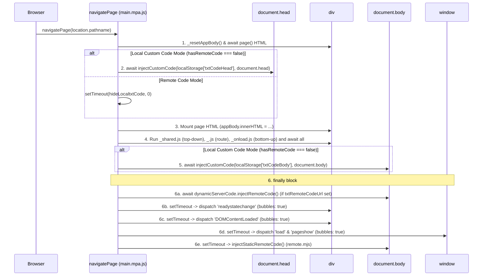

# AGENTS.md

## Project Overview & Training Philosophy

`wordpress-example` is a zero-framework, client-rendered emulation of a **WordPress 6.7 + WooCommerce 9.1.2** e-commerce storefront bundled with **Vite** and deployed to **Cloudflare Pages**.

### Primary Purpose
This repository is built for **quick live demos and hands-on trainee exercises** (specifically for web analytics, Google Tag Manager, `gtag.js`, conversion tracking, DOM scraping, and first-party tag proxying):
1. **Local & Remote Custom Code Injection**: Trainees and instructors can inject arbitrary `<head>` and `<body>` HTML/JS snippets locally via `localStorage` (`/my-account`) or remotely via a Google Docs export channel (`?serverUrlId=<gdocId>`).
2. **Realistic WordPress/WooCommerce "Camouflage"**: Much of the HTML markup, inline `<script>` blocks (e.g., `wcSettings`, `wc_order_attribution`, `wpforms`), and static CSS files in `public/css/` are copied directly from a real WooCommerce site and are intentionally non-functional ("dead code"). **This dead code serves as camouflage** so trainees must inspect, filter, and navigate a realistic, noisy production-like DOM rather than a sterile toy app.
3. **Google Tag First-Party Mode (FPS) Proxy**: Includes a Cloudflare Pages Function (`functions/gtg/[[path]].js`) that proxies `/gtg/*` requests to `https://<tagId>.fps.goog`.
4. **Simulated E-Commerce & Form Flows**: Implements functional catalog browsing, add-to-cart, cart management, checkout, order confirmation, and three distinct contact/inquiry form submission patterns—all backed by `localStorage`.

---

## Strict Guardrails for Agents

1. **DO NOT Alter Code Injection Sequencing (`src/main.mpa.js`)**:
   - The timing and execution order of `injectCustomCode()`, macrotask yields (`setTimeout(..., 0)`), route module loading, and synthetic DOM lifecycle events (`readystatechange`, `DOMContentLoaded`, `load`, `pageshow`) in [`src/main.mpa.js`](file:///home/mingliangc/wordpress-example/src/main.mpa.js) are carefully tuned so third-party tags (like GTM/`gtag.js`) trigger in the exact sequence expected on a real Multi-Page Application. **Do not reorder, remove awaits, or refactor this sequence.**
2. **DO NOT Remove "Dead" Camouflage HTML, CSS, or Inline Scripts**:
   - Do not delete unused WooCommerce classes, unreferenced CSS files in `public/css/`, dummy `<script id="wc-...">` tags, or non-working UI controls (e.g., sorting dropdowns, coupon buttons, footer links) unless explicitly instructed. They are intentional decoys for training.
3. **DO NOT Redesign or Over-Change the Current UI**:
   - Keep the existing visual layout, inline styles, and DOM hierarchy intact. Both internal page controllers and trainee tag triggers rely on the existing DOM structure and selectors.

---

## Tech Stack & Commands

- **Runtime**: Vanilla JavaScript (ES2024+ Modules, `.js` / `.mjs`), raw HTML partials (`src/page/**/_.html`), static WordPress/WooCommerce CSS (`public/css/`).
- **Build & Dev Server**: [Vite](https://vitejs.dev/) (`^7.1.6`, configured with `appType: 'spa'` so all routes resolve to `index.html`).
- **Edge Hosting**: [Cloudflare Pages](https://pages.cloudflare.com/) + [Wrangler](https://developers.cloudflare.com/workers/wrangler/) (`wrangler.jsonc`, `functions/`).
- **PWA / Offline**: `public/manifest.json` + Workbox 6.4.1 Service Worker (`public/sw.js`).
- **Linting, Testing & Editor Configs**: ESLint 9 (`eslint.config.mjs`), Vitest (`src/_test/*.test.js`), `jsconfig.json`, `deno.json`.

| Command | Description |
| :--- | :--- |
| `npm run dev` | Start Vite development server (`http://localhost:5173/`) |
| `npm run build` | Bundle production assets into `./dist` (strips `console` & `debugger`) |
| `npm run preview` | Preview the built `./dist` folder using Vite |
| `npm run build-n-preview` | Run `vite build && vite preview` |
| `npx wrangler pages dev` | Test `./dist` + Cloudflare Pages Functions (`functions/`) locally |
| `npm run lint` | Run ESLint across the repository (`eslint .`) |
| `npm test` | Run Vitest test suite (`vitest`) |

---

## Directory Structure

```text
.
├── index.html                  # App shell (<nav>, #btnInstallApp, #remote-setting__status, #app, #_dialog-alert)
├── vite.config.js              # Vite config (appType: 'spa', drops console & debugger in prod build)
├── wrangler.jsonc              # Cloudflare Pages config (pages_build_output_dir: "./dist")
├── eslint.config.mjs           # ESLint 9 flat config
├── jsconfig.json               # Path aliases (/src/*, @/* -> ./src/*)
├── deno.json                   # Deno compiler/linter config
├── custom-code/                # Sample head.html & body.html snippets for injection testing
├── functions/
│   └── gtg/[[path]].js         # Cloudflare Pages Function: First-Party Mode proxy to <tagId>.fps.goog
├── public/                     # Static assets copied to dist/ root
│   ├── _routes.json            # Routes /gtg/* to the Cloudflare Pages Function
│   ├── manifest.json           # PWA manifest ("display": "standalone")
│   ├── sw.js                   # Workbox 6.4.1 service worker
│   ├── css/                    # Static WordPress 6.7 & WooCommerce 9.1.2 stylesheets (camouflage & layout)
│   └── page/product/img/       # Product catalog images
└── src/
    ├── main.mpa.js             # ACTIVE entry point: pathname-based MPA router & custom code injector
    ├── main.js                 # Legacy/alternative hash-based (#/path) SPA router & code injector
    ├── alert.mjs               # Modal dialog helper driving <dialog id="_dialog-alert">
    ├── remote.mjs              # Fetches default static remote code from Google Docs export URL
    ├── html.js                 # Trusted Types HTML sanitizer & reactive HtmlFragment helper
    ├── IdbWrapper.mjs          # Promise-based IndexedDB wrapper + Gzip stream helpers
    ├── idb_example.mjs         # Example IndexedDB store ('lsa') CRUD implementation
    ├── theme.mjs               # Dark/light mode state & #btnDarkMode toggle helper
    ├── style.css               # Global styles (dark mode, nav, form states, dialog animations)
    ├── _test/
    │   ├── custom code injector test.html # Test fixture documenting expected script & event load order
    │   ├── ecommerce.test.js       # Vitest unit tests for Product, Cart, shipping options, and OrderSummary
    │   ├── plan-fixes.test.js      # Vitest tests for bug fixes, controllers, and /gtg/* proxy
    │   └── features.test.js        # Vitest tests for image routing, shipping UI, IndexedDB order history, and dark mode
    └── page/                   # Route-based HTML templates and JS controllers
        ├── _.html              # Home page (/)
        ├── shop/               # Catalog page (/shop) - _.html, _.js
        ├── product/            # Product pages (/product/<slug>)
        │   ├── product.mjs     # Product model & hardcoded catalog of 6 products
        │   ├── _onload.js      # Shared controller executed on all /product/* routes
        │   └── <slug>/_.html   # 6 individual product HTML templates
        ├── cart/               # Shopping cart (/cart) - _.html, _.js, cart.mjs
        ├── checkout/           # Checkout flow (/checkout) - _.html, _.js
        ├── order-received/     # Order confirmation (/order-received) - _.html, _.js, order-received.mjs
        ├── contact-us/         # Contact & XHR test forms (/contact-us, /contact-us/inquiry-submitted)
        ├── my-account/         # Custom local & remote code injection settings UI (/my-account) - _.html, _.js
        ├── privacy-policy/     # Static privacy policy (/privacy-policy) - _.html
        └── indexeddb/          # IndexedDB test UI (/indexeddb) - _.html, _.js
```

---

## Core Architecture: Routing & Code Injection Sequencing

### 1. How `src/main.mpa.js` Works (Active Entry Point)
[`index.html`](file:///home/mingliangc/wordpress-example/index.html) loads `<script type="module" src="/src/main.mpa.js" async></script>`.
Because Vite runs with `appType: 'spa'`, the server returns `index.html` for every route, while standard `<a href="/...">` links perform full browser navigation (MPA behavior). On every page load, [`src/main.mpa.js`](file:///home/mingliangc/wordpress-example/src/main.mpa.js) dynamically imports the matching HTML partial and route scripts using Vite's `import.meta.glob`:
- `pages`: `import.meta.glob('./page/**/*.html', { eager: false, query: 'raw' })`
- `modules`: `import.meta.glob('./page/**/*.js', { eager: false })`

### 2. Exact Execution & Injection Timeline (`navigatePage`)
Because `index.html` has already begun loading by the time the module router fetches the route template and user scripts, [`src/main.mpa.js`](file:///home/mingliangc/wordpress-example/src/main.mpa.js#L72-L150) carefully emulates the browser's native page-load lifecycle so injected `<head>` and `<body>` scripts behave identically to server-rendered HTML.



#### How `injectCustomCode(htmlCode, intoElement)` Guarantees Execution Order
Defined in [`src/main.mpa.js`](file:///home/mingliangc/wordpress-example/src/main.mpa.js#L9-L55):
1. Parses `htmlCode` inside an inert `<template>` element and clones its child nodes.
2. Iterates over each child node sequentially (`for (let i = 0; i < len; ++i)`):
   - **`<script>` elements**: Recreates a fresh `<script>` element and copies all attributes so the browser executes it:
     - **Synchronous external scripts (`src` present, no `async` attribute)**: Appends the script to `intoElement` and **awaits** its `load` or `error` event (with a `5000ms` timeout safeguard) before moving to the next node. This ensures external library scripts (e.g., `gtm.js` or `gtag/js`) finish loading before subsequent inline `<script>` tags run.
     - **Inline scripts or `async` external scripts**: Appends the script to `intoElement` and **awaits** a macrotask tick (`await new Promise(r => setTimeout(r, 0))`) so synchronous inline code executes before the next node is processed.
   - **`#text` nodes targeted at `document.head`**: Prepends them to `document.body` instead so stray text in head snippets remains visible without corrupting `<head>`.
   - **All other HTML elements**: Appended directly to `intoElement`.

#### Verified Event Sequencing (`src/_test/custom code injector test.html`)
As documented in [`src/_test/custom code injector test.html`](file:///home/mingliangc/wordpress-example/src/_test/custom%20code%20injector%20test.html), any script injected into `<head>` or `<body>` will observe events in this exact deterministic order:
1. `0 inline` (synchronous statements at top of injected `<script>`)
2. `1 inline` (synchronous statements at bottom of injected `<script>`)
3. `2 : setTimeout 0s` (first `setTimeout(..., 0)` registered inside the injected `<script>`)
4. `3 : setTimeout 0s` (second `setTimeout(..., 0)` registered inside the injected `<script>`)
5. `4 : readystatechange` (synthetic event dispatched on `appBody`, bubbles to `document`/`window`)
6. `5 : DOMContentLoaded` (synthetic event dispatched on `appBody`, bubbles to `document`/`window`)
7. `6 : load` (synthetic event dispatched on `window`)
8. `last : pageshow` (synthetic `PageTransitionEvent` dispatched on `window`)
9. Delayed timers (e.g., `setTimeout(..., 4000)`)

---

## E-Commerce Flows, State & Training Touchpoints

### 1. Client-Side Storage (`localStorage`)

| `localStorage` Key | Encoding / Format | Managed By | Description |
| :--- | :--- | :--- | :--- |
| `product-cart` | Hex-encoded UTF-8 bytes of comma-joined `Uint8Array` of JSON `string[]` | [`Cart`](file:///home/mingliangc/wordpress-example/src/page/cart/cart.mjs#L4-L178) | Array of product IDs currently in the cart (max `69` per product ID). |
| `shipping-option` | Option ID string (`free_shipping:1`, `flat_rate:3`, `express_shipping:2`) | [`Cart`](file:///home/mingliangc/wordpress-example/src/page/cart/cart.mjs#L54-L85) | Selected shipping rate option (`$0.00` Free, `$6.80` Flat rate, or `$20.00` Express). |
| `last order` | Hex-encoded UTF-8 bytes of JSON [`OrderSummary`](file:///home/mingliangc/wordpress-example/src/page/order-received/order-received.mjs#L4-L170) | [`OrderSummary`](file:///home/mingliangc/wordpress-example/src/page/order-received/order-received.mjs#L74-L91) | Stores the last completed order (`id`, `date`, `shippingFee`, `userEmailAddress`, `products`). |
| `theme` | `'dark'` \| `'light'` | [`theme.mjs`](file:///home/mingliangc/wordpress-example/src/theme.mjs) | Persists manual dark/light mode selection toggled via `#btnDarkMode`. |
| `txtCodeHead` | Raw HTML string | [`/my-account`](file:///home/mingliangc/wordpress-example/src/page/my-account/_.js#L15-L33) | Custom HTML/JS injected into `document.head` before `#app` HTML is mounted. |
| `txtCodeBody` | Raw HTML string | [`/my-account`](file:///home/mingliangc/wordpress-example/src/page/my-account/_.js#L15-L33) | Custom HTML/JS injected into `document.body` after `#app` HTML and route controllers finish. |
| `txtRemoteCodeUrl` | Google Docs URL (`https://docs.google.com/document/d/<id>/...`) | [`/my-account`](file:///home/mingliangc/wordpress-example/src/page/my-account/_.js#L35-L57) or `?serverUrlId=<id>` | When non-empty, disables local `txtCodeHead`/`txtCodeBody` and fetches `<doc>/export?format=txt` to inject at the end of `document.body`. |

### 2. Hardcoded Product Catalog (`src/page/product/product.mjs`)
[`Product`](file:///home/mingliangc/wordpress-example/src/page/product/product.mjs#L2-L125) defines 6 valid string IDs (all priced in `USD`):
- `'83'`: **3-Speed Bike** — `$115.00` (`/product/3-speed-bike`)
- `'85'`: **Black and White Summer Portrait** — `$115.00` (`/product/black-and-white-summer-portrait`)
- `'75'`: **Crayfish** — `$59.00` (`/product/crayfish`)
- `'87'`: **Leather-Clad Leisure Chair** — `$249.00` (`/product/leather-clad-leisure-chair`)
- `'59'`: **Teddy Bear** — `$13.99` (`/product/teddy-bear`)
- `'89'`: **Vintage Typewriter** — `$90.00` (`/product/vintage-typewriter`)

Passing an unknown ID to `new Product(id)` throws `Error('undefined product id: ' + id)`, which `Cart` catches to automatically reset corrupted cart state (`Cart.reset()`).

### 3. Route-by-Route Behavior & Trainee Scenarios
- **Home (`/`, `src/page/_.html`)**: Static WordPress Twenty Twenty-Four landing page with camouflage blocks and links.
- **Shop (`/shop`, `src/page/shop/_.html` & `_.js`)**: Displays all 6 products. Clicking any `button[href^="?add-to-cart="]` adds 1 item to `Cart` and opens `<dialog id="_dialog-alert">`.
- **Product Detail (`/product/<slug>`, `src/page/product/_onload.js`)**:
  - Shared controller [`_onload.js`](file:///home/mingliangc/wordpress-example/src/page/product/_onload.js) attaches to `form.cart` (main Add to Cart button with quantity input clamped `1..69`), `#commentform` (product review submission), and related-product `button[href^="?add-to-cart="]` buttons.
- **Cart (`/cart`, `src/page/cart/_.html` & `_.js`)**:
  - Renders line items from `Cart`, quantity `＋`/`－` buttons, `Remove item` buttons, subtotal, 3 selectable shipping options (`Free shipping` `$0.00`, `Flat rate` `$6.80`, `Express shipping` `$20.00`), and total.
- **Checkout (`/checkout`, `src/page/checkout/_.html` & `_.js`)**:
  - [`CheckoutSummary`](file:///home/mingliangc/wordpress-example/src/page/checkout/_.js#L7-L68) renders the order summary sidebar, syncs the 3 shipping options with `Cart`, and listens for form submission on the WooCommerce checkout form, captures `input#email`, saves the order via `OrderSummary.save_checkout()` (to both `localStorage['last order']` and IndexedDB), clears the cart, and redirects to `/order-received?order_id=#...#/checkout`.
- **Order Received (`/order-received`, `src/page/order-received/_.html` & `_.js`)**:
  - Resolves `?order_id=` from IndexedDB via [`IdbWrapper`](file:///home/mingliangc/wordpress-example/src/IdbWrapper.mjs) or falls back to `OrderSummary.getLastOrder()`, populates the confirmation summary (`#order-summary` with `data-payment-currency`), line items table with product thumbnails, shipping fee, total payment, and renders an interactive Order History table of past orders stored in IndexedDB (`woocommerce-order-history`).
- **Contact Us (`/contact-us`, `src/page/contact-us/_.html` & `_.js`)**:
  - Contains **three distinct form implementations** to test different form-tracking techniques:
    1. **Contact Form (`#wpforms-form-66-1`)**: Standard HTML `<form>` `submit` event $\rightarrow$ shows custom alert `"submitted!"` $\rightarrow$ reloads page.
    2. **Custom Ajax Form (`#custom-form`)**: A `<div>` (not a `<form>`) whose `<button type="submit">` click handler validates inputs and sends an `XMLHttpRequest` `POST` to `/gtg/example/`, then alerts `"Submitted successfully!"` and reloads. (Also fires a background XHR `POST` to `/gtg/example2/` 2 seconds after page load as a decoy/test request).
    3. **Inquiry Form (`#inquiry-form`)**: Standard `<form>` `submit` event that logs `FormData` and navigates to `/contact-us/inquiry-submitted` (for destination-URL conversion tracking).
- **My Account (`/my-account`, `src/page/my-account/_.html` & `_.js`)**:
  - Provides `#form-custom-code` (`#txtCodeHead`, `#txtCodeBody`, supports `Ctrl+S` shortcut) and `#form__server-url` (accepts a Google Docs URL `https://docs.google.com/document/d/<ID>/...` and reloads with `?serverUrlId=<ID>`).

### 4. Cloudflare Pages Function (`/gtg/*`)
- Defined in [`functions/gtg/[[path]].js`](file:///home/mingliangc/wordpress-example/functions/gtg/%5B%5Bpath%5D%5D.js) and routed via [`public/_routes.json`](file:///home/mingliangc/wordpress-example/public/_routes.json).
- Proxies Google Tag First-Party Mode requests to `https://<tagId>.fps.goog`:
  - Extracts `tagId` from `?id=G-xxx` (removing `id` from forwarded query params) or falls back to the last non-empty path segment.
  - Returns HTTP `400` if no `tagId` can be determined.
  - Handles CORS `OPTIONS` preflight (`204`), forwards `User-Agent`, `Accept`, `Accept-Language`, and Cloudflare geo headers (`X-Forwarded-Country`, `X-Forwarded-Region`, `X-Forwarded-CountryRegion`), forwards `POST` bodies, and adds `Cache-Control: public, max-age=3600`.

---

## Implementation Notes & Codebase Quirks

When maintaining or extending this repository, keep these nuances in mind:
1. **`RemoteCodeInjector.remoteCodeUrl` Default Fallback**:
   - In [`src/main.mpa.js`](file:///home/mingliangc/wordpress-example/src/main.mpa.js#L322) and [`src/main.js`](file:///home/mingliangc/wordpress-example/src/main.js#L403), `get remoteCodeUrl()` returns `localStorage['txtRemoteCodeUrl'] || ''` so that `hasRemoteCode` evaluates to `false` on fresh browser profiles where `localStorage['txtRemoteCodeUrl']` is `undefined`.
2. **MPA Links & Route Controllers**:
   - Product links in [`src/page/cart/_.js`](file:///home/mingliangc/wordpress-example/src/page/cart/_.js) and the "Return to Cart" link in [`src/page/checkout/_.html`](file:///home/mingliangc/wordpress-example/src/page/checkout/_.html) use standard root-relative paths (`/product/<slug>`, `/cart`) for MPA navigation.
   - [`src/page/contact-us/inquiry-submitted/_.js`](file:///home/mingliangc/wordpress-example/src/page/contact-us/inquiry-submitted/_.js) handles the 5-second redirect back to `/contact-us` in MPA mode after `#inquiry-form` navigates to `/contact-us/inquiry-submitted`.
3. **Cart Quantity Input `blur` Handler (`src/page/cart/_.js`)**:
   - The `blur` listener on `.wc-block-components-quantity-selector__input` clamps values `> 69` to `69` and resets values `< 1` or `NaN` to `1` while preserving valid quantities `1..69`.
4. **Production Build Drops `console` & `debugger`**:
   - [`vite.config.js`](file:///home/mingliangc/wordpress-example/vite.config.js#L11-L13) sets `esbuild: { drop: ['console', 'debugger'] }`. Note that Vite only strips `console`/`debugger` from bundled project modules, **not** from runtime-injected trainee snippets in `localStorage` or Google Docs.
